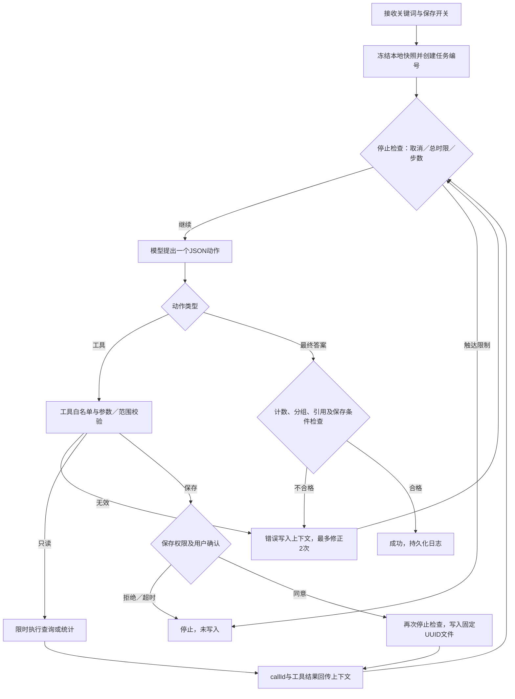

# 实验6 单Agent新闻统计与Harness

本功能在实验5本地知识库上增加可控工具循环，保留原来的RAG问答接口。模型根据目标和每轮工具结果选择下一步；程序不把查询与统计硬编码为顺序执行，但用前置条件保证统计范围和结果正确。

## 使用

要求Node.js 20+、backend依赖，以及根目录.env中的DEEPSEEK_API_KEY。代码与日志不包含密钥。知识库沿用backend/data/knowledge.json（本地快照，非实时联网）。

```powershell
npm run agent --prefix backend -- "乌克兰"
npm run agent --prefix backend -- "乌克兰" --save
npm run test:agent --prefix backend
npm run agent:verify --prefix backend
```

普通模式只读。--save授权模型申请保存，**不是直接批准写入**：终端先显示文件路径和完整简报，键入小写yes才会写入；其他输入拒绝，30秒未答复停止。非交互终端默认拒绝。Ctrl+C可终止任务。请勿在关键词中输入敏感个人信息；关键词与返回的公开新闻片段会发送给DeepSeek。

若无知识库，按实验5方法导入有权使用的公开资料：`npm run rag --prefix backend -- import data/news.json`。实验6为文章计数，对同一document id合并片段；与实验5的Top-4相关片段不同，本次精确子串查询返回全部匹配文章，最多100篇，超过上限报错而不截断后假装全量。数据库无须启动。

## 三个真实工具

| 工具 | Schema与返回 | 权限与幂等 |
|---|---|---|
| query_news | {keyword:string}，必须等于本次任务关键词；返回total与records（id、标题、300字以内片段、来源、链接、日期） | 只访问加载的本地快照；只读，可重复 |
| compute_stats | {ids:string[]}，必须与最近一次查询的全部ID完全相同，不重复；返回total、bySource、ids | 只读；拒绝任意其他ID及子集 |
| save_brief | {}；返回path、alreadySaved、sha256（首次写入） | 需要--save权限、有效统计和人工确认；固定任务UUID文件名，同内容重复调用不重复写入，不同内容拒绝覆盖 |

三个Schema均additionalProperties=false。程序在执行前检查名称、字段、类型、范围、前置条件；不使用eval、shell或模型提供的路径。

## JSON调用协议

使用DeepSeek Chat Completions的JSON输出模式，不依赖原生function calling。每轮仅允许一个动作：

```json
{"kind":"tool","name":"query_news","arguments":{"keyword":"乌克兰"}}
```

模型动作作为assistant消息保留。程序结果用user消息中的type=tool_result、callId、tool、result回传。callId为任务UUID:步骤号。后续请求携带全部本次任务的角色消息；错误结果也加入上下文，不能只打印错误。

最终格式：

```json
{"kind":"final","total":7,"bySource":{"中新网国际 RSS":7},"citations":["rss-2","rss-5","rss-6","rss-7","rss-8","rss-24","rss-28"],"answer":"本地冻结快照共7篇，不代表全部相关新闻。"}
```

Harness检查已实际查询及统计、total/bySource完全一致、citations覆盖全部ID且无重复或虚构；保存任务还检查已成功写入。程序另输出verifiedBrief作为可信统计与链接列表。模型叙述本身不进行完整语义证明，需人工复核，不把自由文本声称完成作为成功标准。

## 控制流程



## Harness模块

- agent/tools.ts：Schema、快照读取范围、工具参数校验、查询、统计、简报生成与幂等写入。
- agent/harness.ts：runAgent管理状态，bounded管理等待与取消，checkFinal核验成功条件，deepseekDecision调用模型；每个事件持久化本地日志。
- scripts/agent.ts：CLI、用户确认、Ctrl+C与进度显示。
- agent/harness.test.ts：故障注入与确认模拟测试。
- scripts/agent-verify.ts：真实云端模型与工具的正常运行验证，独立计算期望ID集合。

默认限制：最大8个模型决策步；每步为一次逻辑模型决策，网络重试不新增步骤但计入modelCalls。模型单次30秒，读工具2秒，总任务120秒（含确认等待），确认30秒；模型网络失败最多重试1次；参数、工具异常与结果检查失败总共最多修正2次，第三次错误停止。日志记录限制、请求消息、模型输出、usage、工具名与参数、结果、错误类型、确认决策、时间、耗时与最终状态。

## 超时与副作用边界

HTTP请求收到AbortSignal后终止本地等待和传输，但不能保证供应商服务端计算已停止。内存查询/统计是有数据量上限的同步操作，不能在执行中间强制中断；执行前后检查终止条件。测试中不响应AbortSignal的只读Promise超时后可能仍在后台，本实现不接受迟到结果，并传入状态副本，避免修改活动任务。

保存动作在确认后再次检查取消和总时限，然后以同步本地wx创建写入。这一短写入不能中途取消，若停止恰好发生在写入期间，可能已生成文件；日志中的savedPath及目标文件是核对依据。写入异常归类WRITE_UNKNOWN，立即停止，不自动重试；需先人工核对。运行日志本身是自动产生的本地审计文件，不需要逐次确认。

## 日志与测试证据

- backend/data/agent/runs/<UUID>.json：状态、messages与事件。
- backend/data/agent/briefs/<UUID>.md：仅确认成功后生成。
- backend/data/agent-tests/latest.json：模拟测试详细事件，simulation=true。
- backend/data/agent-evidence/live-verification.json：真实模型验证摘要，simulation=false。

日志目录已被.gitignore排除；记录时遮挡当前API Key、常见Key样式、电子邮箱和手机号。该脱敏不是通用个人信息识别器，不得输入其他私密数据。进程崩溃时可能留下running日志，后续不自动恢复写入；确认状态不跨进程复用。

## 局限

只支持单关键词的本地文章查询统计，按篇计数而非事件去重，不接入任意命令和网络抓取。程序验证结构化统计和引用，不证明模型自由文本完全无误。固定快照目前为2026-10-20资料；若更换资料，计数将变化。后续可增加任务状态API、页面确认按钮、更稳健日志落盘与经过允许的日期过滤，但不能扩大模型的任意文件访问权限。
